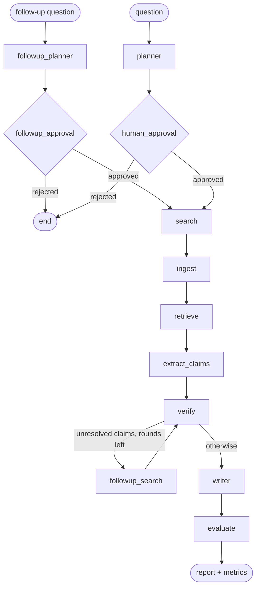

# Architecture

## Pipeline



The diagram LangGraph generates from the compiled graph is in [graph.mmd](graph.mmd).

| Node | Does | Code |
|---|---|---|
| `planner` | Question → objective, scope, outline, 3–5 subquestions with 2–3 search queries each | [nodes/planner.py](../research_agent/nodes/planner.py) |
| `human_approval` | `interrupt()`: pauses until the plan is approved, edited, or rejected | [nodes/planner.py](../research_agent/nodes/planner.py) |
| `search` | Runs every query, de-duplicates URLs, spreads sources round-robin across subquestions | [nodes/search.py](../research_agent/nodes/search.py) |
| `ingest` | Fetch → boilerplate removal → injection sanitization → section-aware chunking → embeddings into pgvector | [nodes/search.py](../research_agent/nodes/search.py) |
| `retrieve` | Hybrid BM25 + vector search, fused with RRF, reranked by the LLM | [nodes/retrieve.py](../research_agent/nodes/retrieve.py) |
| `extract_claims` | Atomic claims (text, source, chunk, entities, numbers, dates, confidence), near-duplicates dropped | [nodes/verify.py](../research_agent/nodes/verify.py) |
| `verify` | Gathers evidence from other sources per claim; the LLM labels each passage; `decide_status` turns that into verified / uncertain / contradicted | [nodes/verify.py](../research_agent/nodes/verify.py) |
| `followup_search` | Targeted search for uncorroborated claims, then back to `verify` (bounded rounds) | [nodes/verify.py](../research_agent/nodes/verify.py) |
| `writer` | Writes the report from **verified claims only**; appendix and references are generated deterministically. After a follow-up it **edits** the report instead (see below) | [nodes/writer.py](../research_agent/nodes/writer.py) |
| `evaluate` | Citation coverage, source diversity, hallucination risk (LLM-as-judge), cost, latency | [evaluation.py](../research_agent/evaluation.py) |

| `followup_planner` | A reader's follow-up question → 1–3 new subquestions, skipping what the report already covers | [nodes/followups.py](../research_agent/nodes/followups.py) |
| `followup_approval` | `interrupt()`, like `human_approval`, for the follow-up's subquestions (skipped for auto-approved jobs) | [nodes/followups.py](../research_agent/nodes/followups.py) |

## Follow-up questions

`POST /research/{id}/followup` re-enters the finished job's checkpoint thread from `START`, which routes
to `followup_planner`. The new subquestions are appended to the plan and listed in `state.active`, so
search, ingest, retrieval, extraction and verification only work on them, adding to the sources,
chunks and claims already there. Earlier claims keep their verdicts; new ones are verified against
every source, old and new.

The writer then edits the report rather than writing a new one. The model returns section edits
(`append` to a section, `insert` a new one, or `replace` one to correct it), which are applied in
code, so untouched sections stay word for word. A rewrite that loses any of its section's citations is
redone once; if it still loses them, that section is kept as it was. The appendix and references are
regenerated, the report is re-scored, and the previous text is kept as an earlier version
(`GET /research/{id}/report?version=1` is the original). Each follow-up gets its own spend limit.

## ResearchState

One Pydantic model, [state.py](../research_agent/state.py), flows through every node. Nodes return partial
updates; LangGraph checkpoints the merged state after each node under `thread_id = job_id`
(SQLite file locally, Postgres in production). That checkpoint is what lets a job:

- **pause** at `human_approval` and be resumed later, by another process if need be;
- **recover from a failure** – `POST /research/{id}/resume` re-runs only the failed node and what follows;
- **survive a restart** – on startup the API resumes every job still marked `queued`/`running`.

## Layers

```
FastAPI (api/main.py)        request ids, rate limiting, daily spend cap, static UI
  └─ ResearchService         job lifecycle; mirrors checkpoint state into research_jobs
       └─ LangGraph graph    nodes + conditional edges + retry policy + checkpointer
            └─ Deps          LLM, embedder, vector store, search, fetcher (fakes in tests)
Postgres + pgvector          research_jobs, chunks(embedding vector(1536)), timeline_events
data/reports/                Markdown report + full JSON state per job (object-storage stand-in)
```

## Verification rules

`decide_status` is deterministic so it can be unit-tested:

- Each source is weighted by `quality` (domain heuristics in [tools/quality.py](../research_agent/tools/quality.py);
  halved if the page attempted prompt injection).
- **contradicted** – contradicting weight ≥ supporting weight.
- **verified** – ≥ 2 independent supporting sources with no contradictions; or one authoritative
  source (quality ≥ 0.8); or a contradiction outweighed 2:1 by ≥ 2 supporting sources (noted as disputed).
- **uncertain** – everything else (single weak source, or narrowly contested). Uncertain,
  uncontradicted claims get one follow-up search round before the verdict is final.
- Claims with figures or dates from sources older than 3 years lose confidence and are noted as possibly stale.

## Prompt-injection defense

1. Strong patterns ("ignore previous instructions", fake `<system>` tags, …) are removed outright.
2. Weak patterns (text addressing an AI) go to an LLM classifier; removed only if it judges them
   instructions. Without a classifier they're removed (fail closed).
3. Every prompt wraps web text in `<passage>` tags and tells the model to treat it as data.
4. The writer never sees web text at all – only verified claim statements.

## Resilience and cost control

- Every external call (LLM, embeddings, search, fetch) retries transient errors with exponential
  backoff and jitter ([resilience.py](../research_agent/resilience.py)); 4xx errors fail fast.
- Nodes get one extra LangGraph-level retry for unexpected errors (not for bugs, bad keys or budget).
- Every LLM call is metered ([llm.py](../research_agent/llm.py)). A job that exceeds `MAX_JOB_COST_USD`
  stops with `BudgetExceeded`; the API refuses new jobs once today's spend (plus a reservation for
  running jobs) reaches `DAILY_COST_CAP_USD`.
